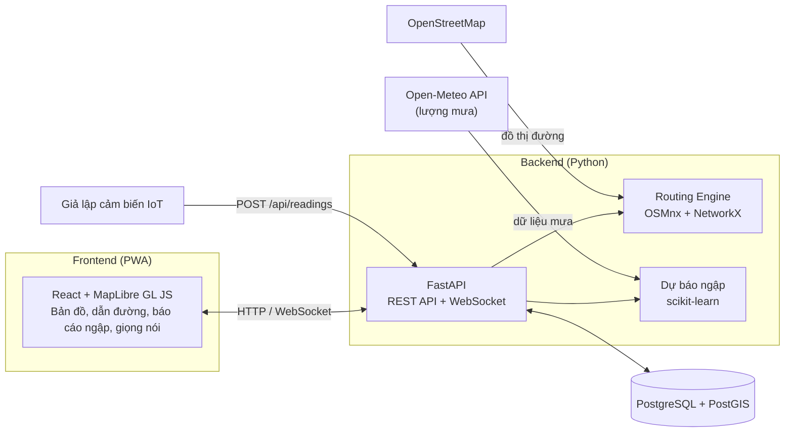

# 🌊 FloodNav – Hệ thống Bản đồ Thông minh Cảnh báo và Điều hướng Tránh Điểm Ngập Lụt Cục bộ

> Dự án tham dự cuộc thi mã nguồn mở – Fullstack A-Z (Database → Backend → Frontend).

## 1. Giới thiệu bài toán

Vào mùa mưa, nhiều tuyến phố và ngõ xóm ở Hà Nội ngập cục bộ, gây tê liệt giao thông và hư hỏng phương tiện. Người dân thường di chuyển theo thói quen, còn các bản đồ phổ thông (như Google Maps) chưa cập nhật **độ sâu điểm ngập** theo thời gian thực và chưa tự đổi lộ trình để né các khu vực này.

**FloodNav** giải quyết bằng cách:

- Thu thập mực nước từ **cảm biến (OT)** và **báo cáo của người dân (crowdsourcing)**.
- Chuyển mực nước (cm) thành **trọng số cản trở** trên đồ thị đường đi, **tách theo loại xe** (xe máy / ô tô).
- **Tự động tính lại lộ trình (re-routing)** cho những người đang di chuyển qua khu vực vừa ngập.
- **Dự báo ngập 30–60 phút tới** từ lượng mưa và dữ liệu lịch sử để chặn đường trước khi ngập thật sự xảy ra.
- **Cảnh báo bằng giọng nói** khi sắp vào vùng ngập.

### Ánh xạ khung H-P-D-I

| Trụ | Nội dung triển khai |
|---|---|
| **H – Human** | Ứng dụng bản đồ web mobile-first: dẫn đường, cảnh báo giọng nói, nút báo cáo ngập 1 chạm |
| **P – Process** | Khi có điểm ngập mới vượt ngưỡng → khoá cạnh đường → re-routing tự động cho các phiên dẫn đường bị ảnh hưởng |
| **D – Data** | Dữ liệu không gian (OpenStreetMap, PostGIS) + dữ liệu luồng (cảm biến, báo cáo, lượng mưa) |
| **I – Intelligence** | Tìm đường Dijkstra/A* với trọng số an toàn ngập nước + mô hình ML dự báo mực nước |

## 2. Kiến trúc công nghệ



| Tầng | Công nghệ | Vai trò |
|---|---|---|
| Database | PostgreSQL 16 + PostGIS | Lưu điểm ngập, chuỗi mực nước, báo cáo, dự báo; truy vấn không gian |
| Backend | Python, FastAPI, psycopg 3 | RESTful API (CRUD), WebSocket đẩy lộ trình mới |
| Tìm đường | OSMnx, NetworkX | Đồ thị đường Hà Nội, thuật toán Dijkstra/A* với trọng số ngập |
| AI | scikit-learn (Gradient Boosting) | Dự báo mực nước sau 30/60 phút |
| Frontend | React, MapLibre GL JS, Web Speech API | Bản đồ, dẫn đường, cảnh báo giọng nói |
| Dữ liệu ngoài | OpenStreetMap, Open-Meteo | Bản đồ đường, lượng mưa (đều miễn phí, mã nguồn mở) |

> Toàn bộ công nghệ sử dụng đều là phần mềm nguồn mở.

### Công thức trọng số cạnh

```
cost(edge) = length × (1 + α · penalty(depth, vehicle))

penalty = 0            nếu depth < 5 cm
        = tăng dần     nếu 5 cm ≤ depth < ngưỡng của xe
        = ∞ (chặn)     nếu depth ≥ ngưỡng của xe   (xe máy ≈ 20 cm, ô tô ≈ 30 cm)
```

## 3. Cấu trúc thư mục

```
floodnav/
├── backend/
│   ├── requirements.txt
│   └── app/
│       ├── main.py          # FastAPI app, các endpoint
│       └── db.py            # kết nối PostgreSQL
├── db/
│   ├── setup_db.py          # tạo database + nạp dữ liệu (không cần psql)
│   └── init/
│       ├── 01_schema.sql    # schema PostGIS
│       └── 02_seed.sql      # dữ liệu mẫu (8 điểm ngập)
├── .vscode/                 # cấu hình chạy/debug bằng VS Code
├── .env.example
└── README.md
```

## 4. Cài đặt và chạy

**Yêu cầu:** Python 3.10+, PostgreSQL 16 + PostGIS.

**Cài PostgreSQL + PostGIS (Windows):** cài PostgreSQL từ https://www.postgresql.org/download/windows/, sau đó mở *Stack Builder* → *Spatial Extensions* → tick **PostGIS**.
(Mac: `brew install postgresql@16 postgis` · Ubuntu: `sudo apt install postgresql postgis`)

```bash
# 1. Tạo môi trường ảo và cài thư viện
python -m venv venv
venv\Scripts\activate            # Mac/Linux: source venv/bin/activate
pip install -r backend/requirements.txt

# 2. Cấu hình kết nối DB
copy .env.example .env           # Mac/Linux: cp .env.example .env
# mở .env và sửa MATKHAU thành mật khẩu PostgreSQL của bạn

# 3. Tạo database và nạp dữ liệu mẫu
python db/setup_db.py

# 4. Chạy backend
cd backend
uvicorn app.main:app --reload
```

- Health check: http://localhost:8000/api/health
- Danh sách điểm ngập (GeoJSON): http://localhost:8000/api/flood-points
- Tài liệu API (Swagger): http://localhost:8000/docs

Reset database: `python db/setup_db.py --reset`

## 5. Thiết kế dữ liệu

| Bảng | Mô tả |
|---|---|
| `flood_points` | Điểm ngập có cảm biến (toạ độ, ngưỡng cảnh báo) |
| `water_readings` | Chuỗi thời gian mực nước (nguồn: sensor / crowd / ai) |
| `reports` | Báo cáo ngập của người dân, tự hết hạn sau 45 phút |
| `predictions` | Kết quả dự báo AI (30/60 phút, điểm rủi ro) |
| `nav_sessions` | Các phiên dẫn đường đang hoạt động, phục vụ re-routing |
| `users` | Người dùng và loại phương tiện |

## 6. Tiến độ

- [x] Thiết kế schema PostGIS, dữ liệu mẫu
- [x] Backend FastAPI kết nối DB, API đọc điểm ngập (GeoJSON)
- [ ] CRUD đầy đủ: điểm ngập, số đo mực nước, báo cáo
- [ ] Xác nhận báo cáo người dân (≥ 3 báo cáo / 100 m / 15 phút)
- [ ] Đồ thị đường OSM và trọng số theo mực nước
- [ ] API tìm đường: nhanh nhất và an toàn nhất
- [ ] Giao diện bản đồ (React + MapLibre)
- [ ] Re-routing thời gian thực qua WebSocket
- [ ] Dẫn đường và cảnh báo giọng nói
- [ ] Giả lập cảm biến IoT
- [ ] Mô hình AI dự báo ngập
- [ ] Dashboard quản trị

## 7. Lưu ý về dữ liệu

Toạ độ các điểm ngập trong dữ liệu mẫu là **gần đúng**, chọn từ các điểm hay ngập ở Hà Nội để minh hoạ. Dữ liệu mực nước và dữ liệu huấn luyện mô hình AI là **dữ liệu giả lập** phục vụ demo, không phải số liệu quan trắc thật.

## 8. Giấy phép

Phát hành theo giấy phép [MIT](LICENSE).
